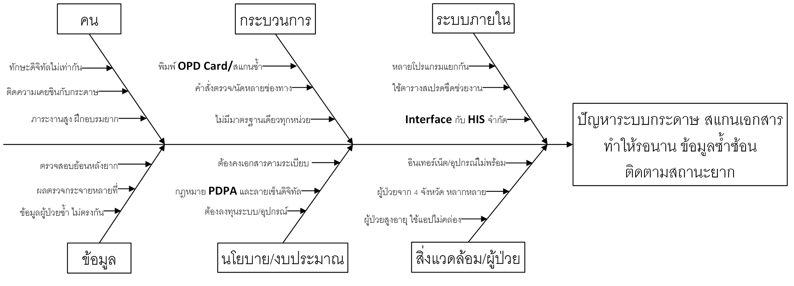
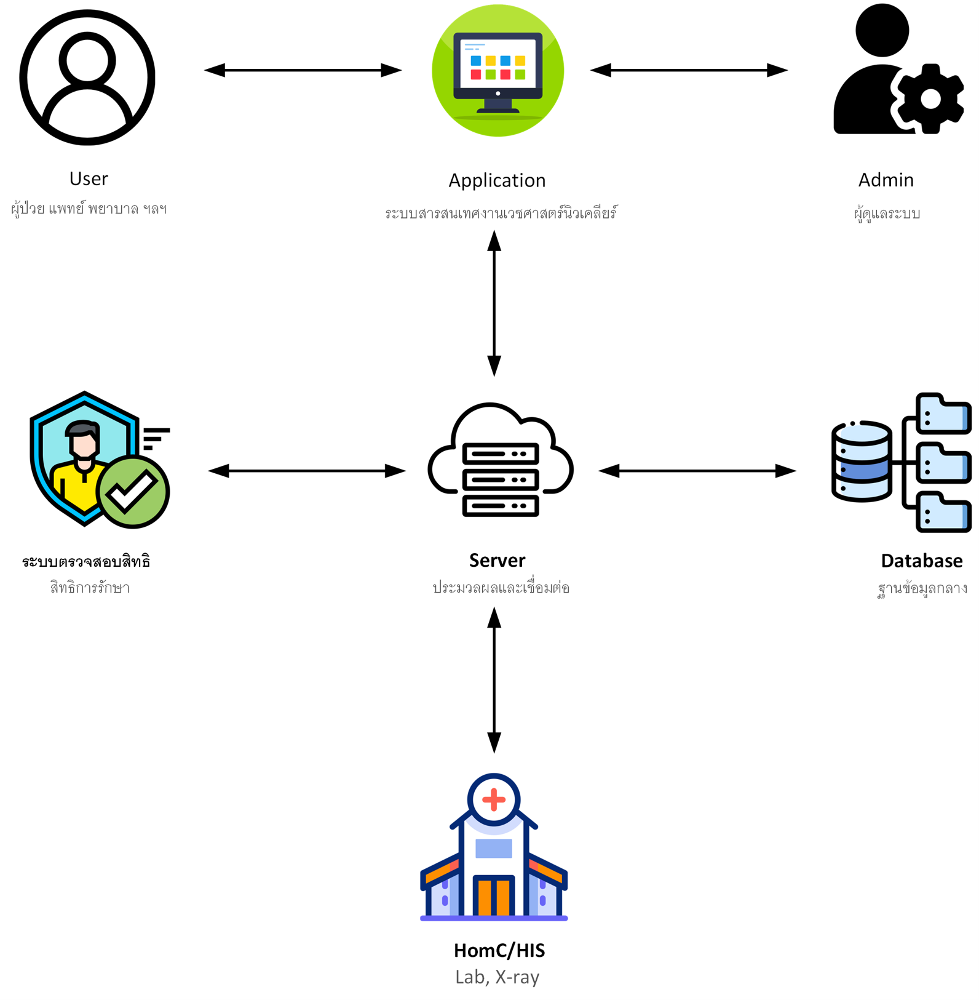
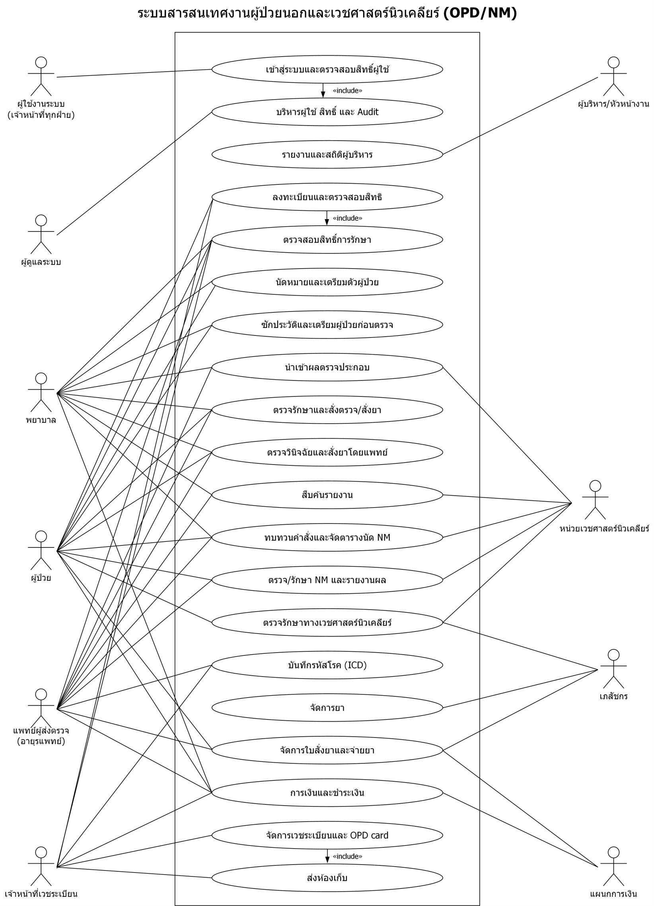
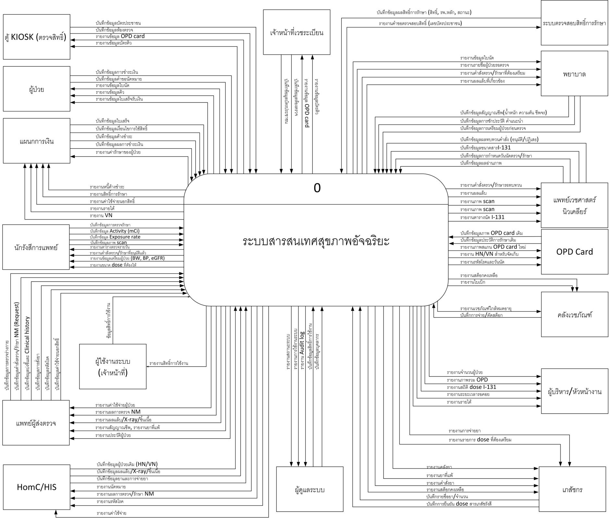
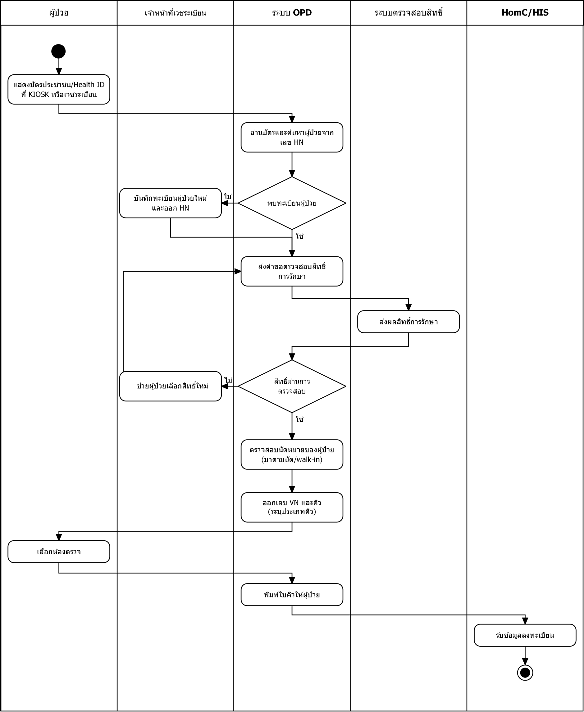
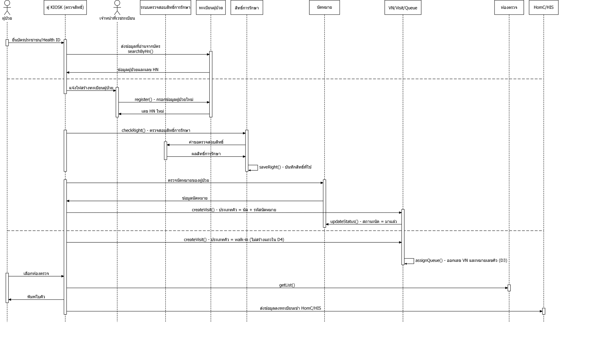
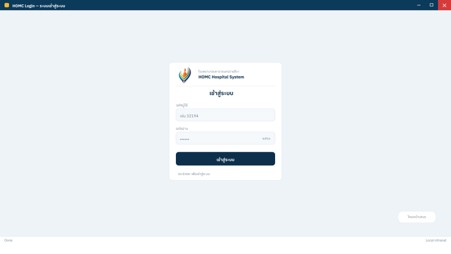
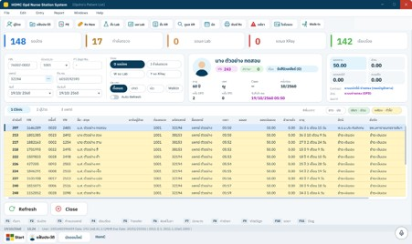
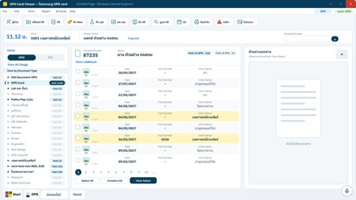
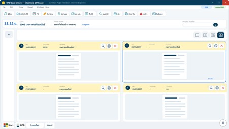

# ระบบสารสนเทศสุขภาพอัจฉริยะ (Smart Health Information System)

**การวิเคราะห์และออกแบบระบบสารสนเทศสุขภาพอัจฉริยะเพื่อการบริการที่เป็นเลิศ**
กรณีศึกษา: ระบบสารสนเทศงานเวชศาสตร์นิวเคลียร์ผู้ป่วยนอก โรงพยาบาลมหาราชนครราชสีมา

> โครงงานรายวิชา **040223363 System Analysis and Design for Mathematics**
> สาขาวิชาคณิตศาสตร์เชิงวิทยาการคอมพิวเตอร์ คณะวิทยาศาสตร์ประยุกต์
> มหาวิทยาลัยเทคโนโลยีพระจอมเกล้าพระนครเหนือ | ปีการศึกษา 1/2569 | ตอนเรียนที่ 1
> อาจารย์ผู้สอน: ผู้ช่วยศาสตราจารย์ ดร.ศักดิ์ชาย ตั้งประเสริฐ

---

## 🔗 ลิงก์สำคัญ

| รายการ | ลิงก์ |
|---|---|
| 📄 รายงานฉบับเต็ม (PDF, 173 หน้า) | [Project_SA_Report.pdf](Project_SA_Report.pdf) |
| 🎨 งานออกแบบ UI (Figma) | [เปิดดูใน Figma](https://www.figma.com/design/BshFbBmVYwlDTwQf0Lg95Y/SA?node-id=9-22&t=7eSySLJzV1WInhsU-1) |
| ▶️ Prototype (Figma) | [ทดลองใช้งาน Prototype](https://www.figma.com/proto/BshFbBmVYwlDTwQf0Lg95Y/SA?node-id=490-1477&p=f&t=7eSySLJzV1WInhsU-0&scaling=min-zoom&content-scaling=fixed&page-id=9%3A22&starting-point-node-id=490%3A1477&show-proto-sidebar=1) |

---

## 📌 ที่มาและปัญหา

งานเวชศาสตร์นิวเคลียร์ผู้ป่วยนอกของโรงพยาบาลยังทำงานกระจายอยู่ในหลายโปรแกรมและเอกสาร ได้แก่

- โปรแกรม HomC (ลงทะเบียน นัดหมาย บันทึกรหัสโรค)
- โปรแกรมดูภาพ X-ray และโปรแกรมดู OPD Card แยกกัน
- Google Sheets สำหรับตารางนัดและการจัดสรรปริมาณสาร I-131
- เอกสารกระดาษ ต้องพิมพ์/สแกน และเก็บเวชระเบียนเป็นกระดาษ

ผลที่ตามมาคือ บันทึกข้อมูลซ้ำซ้อน ทำงานล่าช้า เอกสารผิดพลาดง่าย และติดตามสถานะบริการย้อนหลังได้ยาก

## 🎯 วัตถุประสงค์

ออกแบบระบบสารสนเทศแบบ **รวมศูนย์ (Centralized)** ที่เชื่อมข้อมูลตั้งแต่ลงทะเบียน ตรวจสิทธิ์ นัดหมาย ซักประวัติ ตรวจรักษา สั่งตรวจ/สั่งยา จัดสรรสารเภสัชรังสี ชำระเงิน จนถึงจัดเก็บเวชระเบียนและรายงานผู้บริหาร เพื่อ

- ลดความซ้ำซ้อนในการบันทึกข้อมูลและลดการใช้กระดาษ
- เพิ่มความถูกต้องและความปลอดภัยในการให้สารเภสัชรังสี
- รองรับการตรวจสอบย้อนหลัง (Audit Log)
- สนับสนุนนโยบาย Smart Hospital และ Paperless Hospital

---

## 🧩 ภาพรวมระบบ

**องค์ประกอบของระบบ:** ผู้ใช้งาน (ผู้ป่วย, เจ้าหน้าที่เวชระเบียน, พยาบาล, แพทย์เวชศาสตร์นิวเคลียร์, แพทย์ผู้ส่งตรวจ, นักรังสีการแพทย์, เภสัชกร, เจ้าหน้าที่การเงิน), Admin/ผู้บริหาร, Application, Server, ฐานข้อมูลกลาง, ระบบ HomC/HIS เดิม และระบบตรวจสอบสิทธิ์การรักษา

**ขอบเขตการทำงานหลัก**

1. ลงทะเบียนและตรวจสอบสิทธิ์ (ผ่านตู้ KIOSK หรือเวชระเบียน)
2. นัดหมายและจัดสรร dose I-131
3. ซักประวัติและบันทึกสัญญาณชีพ
4. แพทย์สั่งตรวจและสั่งยา
5. ตรวจรักษาทางเวชศาสตร์นิวเคลียร์และถ่ายภาพ scan
6. บริหารสารเภสัชรังสีและคลังยา
7. ชำระเงินและจ่ายยา
8. บันทึกรหัสโรค (ICD)
9. จัดการภาพ OPD Card และส่งห้องเก็บเอกสาร
10. รายงานสถิติผู้บริหาร และ Audit Log

**ฐานข้อมูลกลาง:** 26 ตาราง (D1–D26)
**เชื่อมต่อระบบภายนอก:** HomC/HIS เดิม และระบบตรวจสอบสิทธิ์การรักษา

---

## ตัวอย่างงานออกแบบ Diagram

<!-- ใส่รูปที่ export จาก Figma / รายงาน แล้วแก้ชื่อไฟล์ให้ตรง -->

| Fishbone Diagram | System Diagram |
|---|---|
|  |  |

| Use Case | DFD level 0 |
|---|---|
|  |  |

| Activity Diagram | Sequence Diagram |
|---|---|
|  |  |

## ตัวอย่างงานออกแบบ User Interface

| หน้า Login | หน้า HomC |
|---|---|
|  |  |

| หน้า OPD Card | หน้า OPD Card เปรียบเทียบ |
|---|---|
|  |  |

---

## 👥 คณะผู้จัดทำ

| ชื่อ | รหัสนักศึกษา |
|---|---|
| นายเนติพงศ์ พฤกษเศรษฐ | 67-040226-1252-8 |
| นายพีรณัฐ อนันต์ธีรทัต | 67-040226-1029-1 |
| นายภัคพล สิงห์เส | 67-040226-1050-9 |
| นางสาวจุฑามาศ พรหมชนะ | 67-040226-1248-0 |
| นายอดิศร สังวาลย์ | 67-040226-1058-4 |
